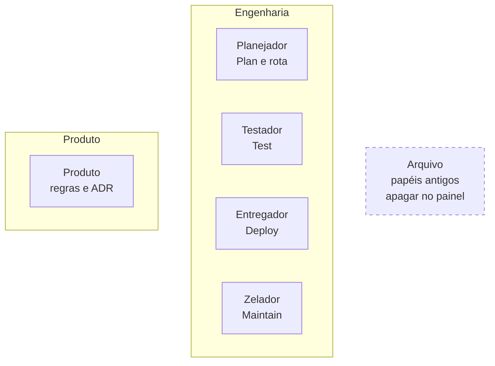
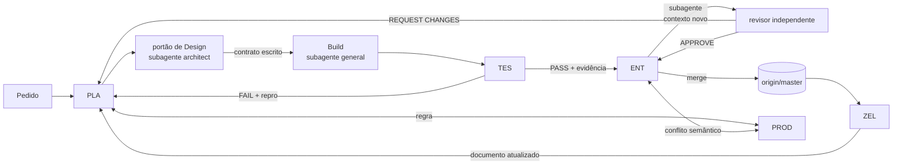

# Mapa do time

## Organização no painel

O Build não aparece: é subagente. O Arquiteto, o Revisor independente e o Comment Sicko também são subagentes e não ocupam a sidebar.

## Fluxo por etapa

## O que cada portão exige

| Etapa | Entrada | Saída | Quem barra |
| --- | --- | --- | --- |
| Plan | pedido classificado | `plano-<slug>.md` com playbook e rota | Planejador |
| Design | plano | tipos, assinaturas, fronteira, fora de escopo | Planejador |
| Build | bloco de Design | código com teste vermelho antes | Subagente do Planejador |
| Test | Build verde | PASS com evidência no disco | Testador |
| Deploy | PASS | PR verde e merge | Entregador + revisor |
| Maintain | merge | documento com carimbo | Zelador |

## Camada de disco

| Caminho | O que guarda |
| --- | --- |
| `PLANO.md` | fonte de verdade do time |
| `roles/` | rubricas dos agentes e briefs dos subagentes |
| `packs/fluxo-dev` | skill que operacionaliza o fluxo de uma tarefa |
| `packs/manutencao-projeto` | cinco skills de Maintain |
| `<repo>/docs/pstack/plano-*.md` | plano do Planejador |
| `<repo>/docs/pstack/evidencia/` | prova do Testador |

## Pontos de atenção

- Um agente persistente por etapa; o Build é sempre subagente.
- O revisor independente não é bot: é contexto novo.
- Merge só com pedido do usuário.
- Documento sem carimbo é documento sem confiança.
