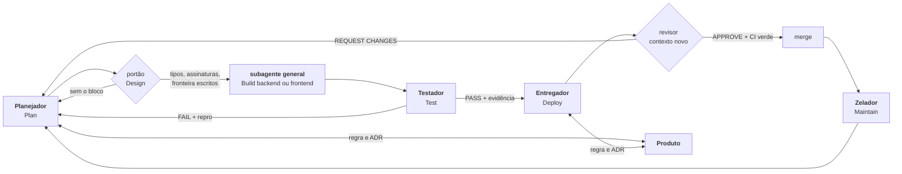

# Time pstack no OpenBot

Estrutura para rodar trabalho de desenvolvimento com agentes organizados por **etapa do ciclo de vida**, não por cargo.

```text
Plan -> Design -> Build -> Test -> Deploy -> Maintain -> Plan
```

Cada etapa tem entrada, artefato de saída e um portão. A etapa seguinte não começa sem o artefato da anterior.

## Etapas e donos

| Etapa | Dono | Artefato de saída | Portão |
| --- | --- | --- | --- |
| Plan | Planejador | `docs/pstack/plano-<slug>.md` com playbook, checklist, contrato e rota | o critério de pronto está escrito |
| Design | Planejador, com subagente `architect` | tipos, assinaturas, fronteira de módulo e fora de escopo no plano | sem esse bloco, Build não começa |
| Build | Subagente de propósito geral do Planejador | código com teste vermelho antes e `deslop` no diff | build e suíte local verdes no worktree |
| Test | Testador | PASS ou FAIL na superfície real, com evidência em disco | PASS com caminho de evidência |
| Deploy | Entregador | PR revisável, CI, veredito independente | APPROVE e pedido explícito do usuário |
| Maintain | Zelador | documento atualizado com carimbo de data e commit | documento cita `arquivo:linha` |

**Produto** é transversal. Não é dono de etapa: responde qual comportamento é o correto quando duas mudanças se contradizem, e propõe ADR quando a mesma decisão aparece duas vezes sem regra escrita.

## Agentes persistentes

| Agente | Papel | Nunca faz |
| --- | --- | --- |
| **Planejador** | Dono do Plan e da rota entre portões. Única porta de entrada. | Escrever feature grande, merge, deploy, veredito do diff |
| **Testador** | Suíte automatizada e prova na superfície real | Editar código de produção, dar veredito do diff |
| **Entregador** | PR, CI, conflito de merge e merge final | Resolver conflito semântico sozinho, deploy, force-push |
| **Zelador** | Documentos vivos do projeto | Editar código, escolher qual lado está certo numa divergência |
| **Produto** | Regra de produto e ADRs | Editar código, resolver conflito, fazer merge |

O Build não é persistente: é um subagente por metade, criado no turno e descartado no fim.

## Camada descartável

Aberta por quem precisa, dentro do próprio turno, como subagente. Não aparece na sidebar.

| Papel | Tipo de subagente | Quando |
| --- | --- | --- |
| Arquiteto | propósito geral | Portão de Design, modelagem de domínio, arena de protótipos |
| Construtor de Build | propósito geral | Uma metade por vez, com `roles/build-subagente.md` |
| Revisor independente | propósito geral | Veredito do diff antes do merge, em contexto novo, com `roles/revisor-subagente.md` |
| Comment Sicko | propósito geral | Revisão de comentários no diff, com `roles/comment-sicko-subagente.md` |
| Batedor | somente-leitura | Investigação read-only, resposta citada |
| Design no OpenDesign | propósito geral, ou o próprio turno | UI, protótipo e design system pelas ferramentas `open-design` do MCP do OpenBot |

Regra de ouro: subagente novo a cada rodada. Só reaproveita o mesmo subagente quando o estado local é caro de mover, como checkout, processo vivo ou mudança não commitada.

## Fluxo



Duas vias, um critério:

- **Rápida.** Reversível, blast radius baixo, projeto com `verify-<app>` já provado. Planejador e um subagente de Build resolvem no turno.
- **De gate.** Blast radius alto, primeira tarefa no projeto, app nativo ou mudança de contrato. Passa por Test e Deploy em turnos separados.

Tarefa trivial não abre subagente nem dev. O Planejador resolve e responde.

## Portão de Design

Antes de qualquer Build, o plano responde:

- quais tipos existem e o que cada um significa;
- qual a assinatura pública de cada módulo tocado;
- onde fica a fronteira, o que este trabalho não invade;
- o que fica fora de escopo nesta rodada.

Roda num subagente com a skill `architect`. Quando houver duas formas defensáveis, rode `arena` para comparar. Se o pedido é trivial e o desenho é óbvio, escreva uma linha no plano dizendo por que o portão foi dispensado.

## Profundidade do Plan

Nem todo pedido paga `how` e `why`. A profundidade segue o risco:

| Risco | O que roda | Registro |
| --- | --- | --- |
| Trivial, reversível, área conhecida | nada | uma linha dizendo por que dispensou |
| Médio, área conhecida com histórico | `how` de uma fatia e `why` estreito, só git e GitHub | blocos curtos "Como funciona" e "Por que assim" |
| Alto, área nova, fronteira de módulo ou regressão | `how` + `why` | os dois blocos; o Design é obrigatório |

`teach` não é portão. É comunicação: explica o trabalho depois, quando o usuário pede.

## Teste, duas camadas

| | Suíte | Superfície |
| --- | --- | --- |
| Prova | comportamento isolado, repetível em segundos | a jornada real, com o app em pé |
| Ferramenta | suíte do repo | skill `verify-<app>` |
| Evidência | falha antes, passa depois | captura, log, estado do banco |
| Quando | antes de implementar, e na auditoria | depois do verde, antes do Deploy |

Uma camada não cobre a outra. Sem skill de verificação não existe "pronto"; existe "não verificado".

## Deploy e veredito independente

O Entregador não aprova o próprio PR e não corrige o código do autor para ele passar. Ele chama um subagente em contexto novo com `roles/revisor-subagente.md`, que devolve APPROVE ou REQUEST CHANGES com `arquivo:linha`.

Merge exige quatro condições juntas: PASS do Testador, APPROVE do revisor, CI verde e pedido explícito do usuário. Sem pedido, abre o PR e para.

## Maintain

Cinco documentos, cinco skills: `manter-contexto` (AGENTS.md), `manter-produto` (regras e ADRs), `manter-testes` (pirâmide e lacunas), `manter-navegacao` (telas e jornadas), `manter-design` (tokens e componentes).

Contrato comum: diff mínimo, `arquivo:linha` como origem, carimbo de data e commit, `DIVERGE:` quando documento e código se contradizem, `NÃO VERIFICADO` em vez de suposição.

## Fecho de tarefa e contexto

Contexto grande não é o problema por si. O problema é contexto velho contradizendo o presente. A defesa é estado em disco e contexto fresco por tarefa.

Uma tarefa fecha quando o merge aconteceu e o Maintain terminou ou foi dispensado com motivo. Antes de limpar o chat, escreva o handoff:

```text
Estado: branch, worktree, PR
Feito: ...
Em voo: ...
Próximo: ...
Evidência: caminhos
```

Cada agente limpa o próprio chat no fim da própria parte. Ninguém limpa o chat de outro. Rotina já roda em sessão nova por execução.

## Regras que valem para todos

1. Ler o `AGENTS.md`, o `CONTEXT.md` e os ADRs do projeto antes de tocar em qualquer arquivo dele.
2. Sem skill de verificação não existe "pronto". Existe "não verificado".
3. Toda prova de mudança visível leva imagem.
4. Não inventar comando, caminho, API, número. Se falta dado, dizer o que falta.
5. Resposta final começa pelo resultado, depois a prova, depois o risco.
