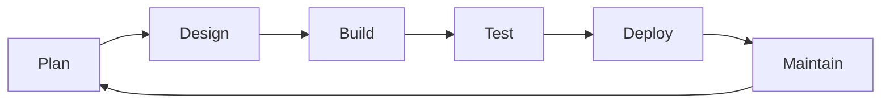

# Time pstack no OpenBot

Um template de time de agentes de IA para desenvolvimento de software, organizado por etapa do ciclo de vida:

```text
Plan -> Design -> Build -> Test -> Deploy -> Maintain -> Plan
```

Não é um framework de código. É uma estrutura de papéis, portões, artefatos e skills para rodar trabalho de dev com agentes que verificam o que fazem.

## O que tem aqui

| Caminho | O que é |
| --- | --- |
| `PLANO.md` | Fonte de verdade: papéis, portões, contexto e regras |
| `MAPA.md` | Sidebar e fluxo por etapa |
| `WORKFLOW.md` | Matriz de etapas, skills e lentes |
| `roles/` | Rubricas dos agentes persistentes e briefs dos subagentes |
| `packs/fluxo-dev` | Skill que operacionaliza o fluxo de uma tarefa |
| `packs/manutencao-projeto` | Cinco skills de Maintain |

O pstack e o cursor-team-kit não são redistribuídos aqui. Instale-os das fontes originais.

## Como usar

1. **Clone o repositório** e leia `PLANO.md`. Ele explica o desenho antes de qualquer comando.
2. **Instale o pstack** da fonte original ([cursor/plugins](https://github.com/cursor/plugins/tree/main/pstack)) na biblioteca de skills do seu ambiente de agentes. Ele é a base de Plan, Design, Build e Test.
3. **Instale as skills deste repo** na biblioteca local:
   - `packs/fluxo-dev`
   - `packs/manutencao-projeto`

   No OpenBot, use a biblioteca de skills e instale nos agentes. Em outro ambiente, aponte o agente para o `SKILL.md` do pack. Nos papéis, `pstack/` significa a pasta do pack pstack instalado.
4. **Crie os cinco agentes persistentes** com as descrições de `roles/`: Planejador, Testador, Entregador, Zelador e Produto. O Build não é agente persistente: é um subagente `general` com o brief `roles/build-subagente.md`.
5. **Crie os subagentes de apoio** a partir dos briefs: revisor independente (`roles/revisor-subagente.md`) e Comment Sicko (`roles/comment-sicko-subagente.md`).
6. **Configure o mapa de modelos** em `~/.agents/pstack-models.md`, se o seu ambiente permitir modelos por subagente. Sem isso, todos herdam o modelo do pai.
7. **Adapte o projeto alvo**: `AGENTS.md`, `CONTEXT.md`, `docs/` e a skill `verify-<app>`. O time é transversal; o contexto do produto mora no repo do produto.
8. **Rode a primeira tarefa pelo Planejador.** Ele classifica, abre o plano, passa pelo Design, delega o Build, chama o Testador e o Entregador. O merge espera pedido explícito do usuário.

## O ciclo



- **Plan:** classifica o pedido, escolhe o playbook, escreve o plano e a rota.
- **Design:** tipos, assinaturas, fronteira e fora de escopo antes do código.
- **Build:** subagente por metade, teste vermelho antes, `deslop` no diff.
- **Test:** suíte, superfície real e evidência; `swarm` para várias fatias.
- **Deploy:** PR revisável, CI, veredito independente; merge só com pedido.
- **Maintain:** documentos vivos com `arquivo:linha` e carimbo de data e commit.

## Princípios

1. **Estado em disco.** Plano, evidência e documento vencem a memória do chat.
2. **Contexto fresco.** Subagentes nascem e morrem na tarefa; agentes persistentes limpam o próprio chat no fecho.
3. **Verificação antes de pronto.** Sem PASS na superfície real, existe "não verificado".
4. **Independência.** Quem constrói não dá o veredito do próprio diff.

## Personalização

Renomeie agentes, troque etapas e adicione skills. O que não deve mudar é o contrato de cada portão: entrada, artefato de saída e quem barra. Sem isso, o time volta a ser um organograma.

## Créditos

O método pstack é de Lauren ([@poteto](https://x.com/poteto)), em [cursor/plugins](https://github.com/cursor/plugins). O cursor-team-kit é do mesmo projeto. Este repositório é uma adaptação independente para o OpenBot, sem vínculo com Cursor.

## Licença

MIT. Veja [`LICENSE`](./LICENSE). O pstack e o cursor-team-kit mantêm as licenças dos projetos originais.
